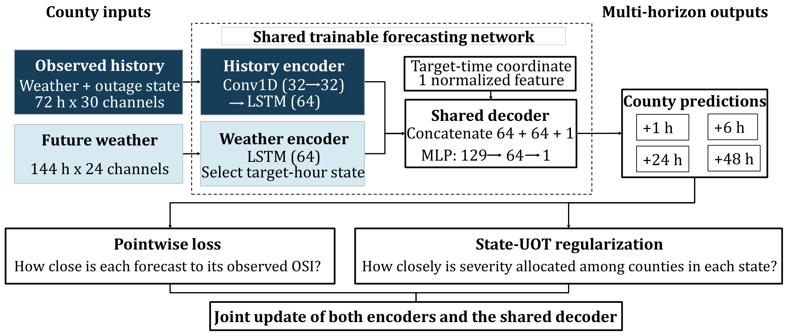
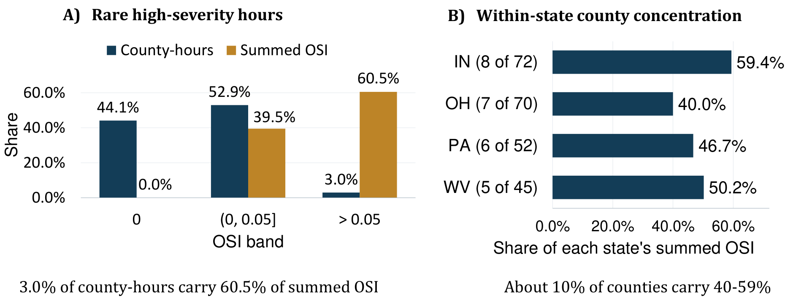
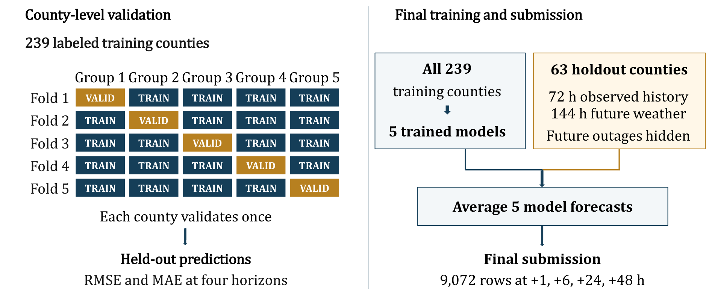
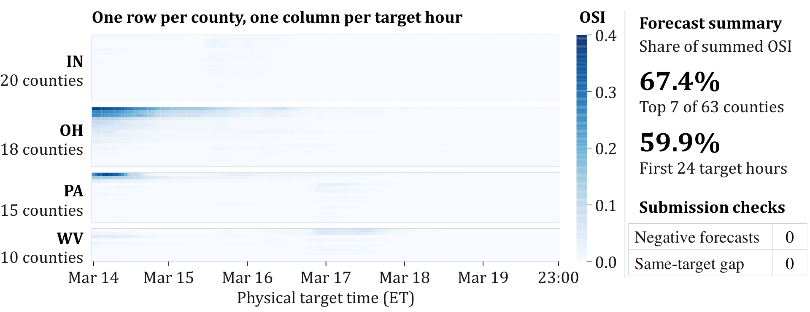
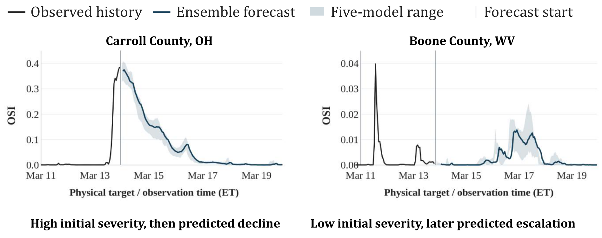

# Coherent Multi-Horizon Forecasting of Power Outage Severity with State-Wise Unbalanced Optimal Transport

**Team SIOL · INFORMS 2026 Data Mining Society Data Challenge — Finalist**

**Amirhossein Eskorouchi**¹ · **Abhro Shome Pias**² · **Dongmin Ethan Kang**¹ · **Munirul Alam**²  
¹ Mississippi State University · ² Auburn University

[**Presentation (PDF)**](docs/presentation/0Final%20Presentation%20%28Data%20Chalenge%29.pdf) · [**Project website**](https://amirhossein-eskorouchi.github.io/projects/state-uot-outage-forecasting/) · [**Reproducibility guide**](docs/REPRODUCIBILITY.md) · [**Methodology**](docs/METHODOLOGY.md)



## Overview

Power outages evolve abruptly during severe weather, and the burden is uneven across counties. We developed a **dual-stream, target-time-consistent forecasting model** that combines county-level temporal prediction with **state-wise unbalanced optimal transport (State-UOT)** regularization. The goal is to predict the *outage severity index* (OSI) across multiple future horizons while learning how severity is distributed among counties within a state.

The work was presented as a finalist submission to the **INFORMS 2026 Data Mining Society Data Challenge** on October 31, 2026.

| Competition setting | Value |
| :--- | :--- |
| Geographic coverage | Indiana, Ohio, Pennsylvania, West Virginia |
| Development / held-out counties | **239 / 63** (county-disjoint) |
| Available observed history | **72 hours** of weather and outage state |
| Available future weather | **144 hours** |
| Forecast horizons | **+1, +6, +24, +48 hours** |
| Held-out submission | **9,072 county–forecast-origin rows** |
| Final inference | **Five full-data models**, averaged across random seeds |

## Key ideas

- **Dual-stream temporal encoding.** A Conv1D–LSTM encoder represents the observed weather/outage history, while a separate LSTM encodes supplied future weather.
- **Physical-target-time consistency.** The shared decoder uses a county-history representation, a target-hour weather representation, and a normalized target-time coordinate. Distinct origin/horizon requests for the same county and physical target hour yield identical deterministic predictions.
- **State-UOT regularization.** Training combines a masked pointwise loss on `log1p(OSI)` with a state-conditioned unbalanced Sinkhorn divergence on the predicted and observed county severity masses. Counties form a **categorical support**: this regularizer does **not** use geographic distances or grid connectivity.
- **County-held-out evaluation.** Five-fold county-level validation is used for model selection and assessment. The final five-model ensemble is trained on all 239 labeled counties and applied to the 63 held-out counties.

For the mathematical formulation and training protocol, see [Methodology](docs/METHODOLOGY.md).

## Why distribution-aware forecasting?



In the labeled training data, just **3.0% of county-hours** with OSI above 0.05 account for **60.5% of summed OSI**. Within each state, about one-tenth of the counties account for roughly **40–59%** of summed severity. These are *descriptive training-set statistics*, not official competition accuracy metrics.

## Validation and forecast examples



**Validation** uses held-out counties, with RMSE and MAE evaluated at the four forecast horizons. **Final prediction** is separate: five seeds are trained on all 239 development counties and their outputs are averaged for the unseen counties.



The heatmap displays the final model's **predictions**, grouped by state and physical target hour. The largest seven of the 63 counties represent **67.4% of total predicted OSI**, and the first 24 target hours account for **59.9%**. These statistics summarize predicted severity only; **withheld test labels are not available, so this is not a measure of held-out accuracy**.



Two contrasting examples: Carroll County, Ohio, and Boone County, West Virginia. The shading represents the **range across five trained models**, not a calibrated uncertainty or confidence interval.

## Repository contents

```text
.
├── FINAL_TRIAL22_END_TO_END.py        # Original self-contained final training / inference script
├── requirements.txt                  # Original pinned Python dependencies
├── assets/
│   └── figures/                      # Five project figures
├── docs/
│   ├── presentation/
│   │   └── 0Final Presentation (Data Chalenge).pdf
│   ├── METHODOLOGY.md
│   ├── REPRODUCIBILITY.md
│   ├── RESULTS_AND_LIMITATIONS.md
│   └── ORIGINAL_SUBMISSION_README.txt
├── .github/workflows/static-checks.yml
├── .gitignore
└── CITATION.cff
```

## Reproduce the final submission

> **Official input data are not included.** Obtain `DM_Train.csv`, `DM_Test.csv`, and `sample_submission.csv` from an authorized source, subject to the challenge's redistribution terms.

The original self-contained submission script expects all **three input CSV files in its own directory** (the repository root). On Windows, open a PowerShell terminal in this folder and run:

```powershell
python -m venv .venv
.\.venv\Scripts\Activate.ps1
python -m pip install --upgrade pip
python -m pip install -r requirements.txt
python FINAL_TRIAL22_END_TO_END.py
```

The run trains **five full-data models** using seeds `10000, 10017, 10042, 10073, 10123`, creates an ensemble forecast, and performs strict submission checks. The expected competition-ready file is:

```text
final_trial22_state_uot_submission/competition_ready/prediction_file.csv
```

Training is computationally demanding; a suitable GPU and environment matching the pinned dependencies are recommended. **The included GitHub workflow only checks Python syntax and presence of documentation; it does not train or evaluate the model.** Details, inputs, and outputs are in [the reproducibility guide](docs/REPRODUCIBILITY.md).

## Data, privacy, and responsible interpretation

- The official CSVs, model checkpoints, temporary artifacts, and prediction outputs are **not distributed** in this repository. `.gitignore` protects common input/output paths, but **review `git status` before every public push**.
- The presented held-out figures show forecasts, **not observed test outcomes**. No held-out test RMSE or MAE is claimed.
- The State-UOT loss is state-conditioned and distributional; it should not be interpreted as an explicit model of spatial adjacency, power-grid structure, or restoration operations.
- Further evaluation on independent storms, geographies, and operational settings is needed before any real-world deployment.

## Citation and presentation

If you build on this work, please credit the full **Team SIOL** author list. A machine-readable citation is provided in [`CITATION.cff`](CITATION.cff).

**Presentation:** *Coherent Multi-Horizon Forecasting of Power Outage Severity with State-Wise Unbalanced Optimal Transport*, INFORMS 2026 Data Mining Society Data Challenge Finalist Presentation, October 31, 2026. [View the complete 17-slide PDF](docs/presentation/0Final%20Presentation%20%28Data%20Chalenge%29.pdf).

**Licensing:** This release does not assign an open-source license to the collaborative research code. Permission to reuse or redistribute the code should be clarified with the authors before a license is added.
