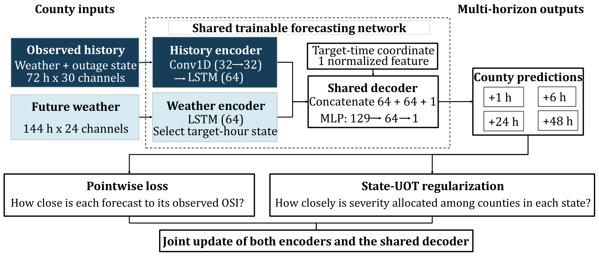

# Methodology

This document describes the **submitted final model**, not a proposed variant. For the original presentation, see [the 17-page PDF](presentation/0Final%20Presentation%20%28Data%20Chalenge%29.pdf).

## Prediction task

The four-state challenge contains **239 labeled training counties** and **63 held-out test counties**. Each county has a 72-hour window of observed historical weather and outage-state information. For the future 144-hour period, supplied weather is available, but future outage-state observations for test counties are withheld.

For forecast origin `t` and horizon `h ∈ {1, 6, 24, 48}`, the physical target index is `τ = t + h`. Targets beyond the end of the future period are not scored and are left missing in the submission template. A total of **9,072** county–forecast-origin rows are submitted for the 63 held-out counties.

## Architecture

The final network has three stages:

1. **History encoder** — temporal convolutions followed by an LSTM summarize the fixed 72-hour county-specific history (weather and outage state).
2. **Weather encoder** — a separate LSTM processes 144 hours of supplied future-weather features, producing a representation aligned to each physical target hour.
3. **Shared decoder** — an MLP combines the county-history representation, the future-weather representation at the target hour, and `ξ(τ) = τ / 143` to predict `log(1 + OSI)`. The result is inverted to the nonnegative raw OSI scale.

Because `t` and `h` affect decoder inputs only through `τ = t + h`, two valid requests for the **same county and physical target hour** use identical decoder inputs and therefore return the same deterministic result from the same model. This property follows from the network design under the competition's fixed-history information structure.

## Training objective

The forecasting network is jointly trained using a weighted sum of complementary losses:

`L_total = L_pointwise + λ(epoch) × L_state-UOT`

- **Pointwise:** masked SmoothL1 between the predicted and observed `log1p(OSI)` at valid county–target requests.
- **State-UOT:** a debiased unbalanced Sinkhorn divergence between predicted and observed **raw-OSI masses** on categorical county support, computed separately within states and physical target hours. The unbalanced formulation can account for mismatches in total mass.
- **Schedule:** the State-UOT coefficient is introduced according to the frozen warm-up/ramp schedule used in the final submitted script.

The State-UOT component **does not encode road-network distances, electrical-grid connectivity, or geographic county-to-county distance**; its state conditioning provides a distribution-level signal in addition to individual county prediction errors.

## Model selection and validation

County-level five-fold validation leaves whole counties out of the training data within each fold. Horizon-specific **RMSE and MAE** are used for model comparison. After model selection and robustness confirmation, the submitted configuration was frozen. No held-out test labels are used for tuning.

Five instances of the selected model are trained on **all 239 labeled counties** using actual training seeds `10000`, `10017`, `10042`, `10073`, and `10123`. Their test forecasts are **averaged** to form the final submission for **63 held-out counties**.

The final script performs output validation including target ordering, expected missing values, nonnegative outputs, and prediction agreement for repeated physical target hours.

## What the figures do—and do not—demonstrate

- Severity concentration figures summarize the *labeled development data*.
- Held-out heatmaps and trajectories display *model predictions*, not observed ground truth.
- The trajectory shading is the cross-seed forecast range, not a calibrated predictive interval.
- Generalization is assessed through county-held-out validation; the uploaded materials do not establish a numerical out-of-sample accuracy score for the withheld official test labels.

## Source of details

The architecture, dataset breakdown, validation design, and study findings are taken from the supplied final presentation and original submission code. The Python implementation remains unchanged; see `FINAL_TRIAL22_END_TO_END.py` at repository root.
